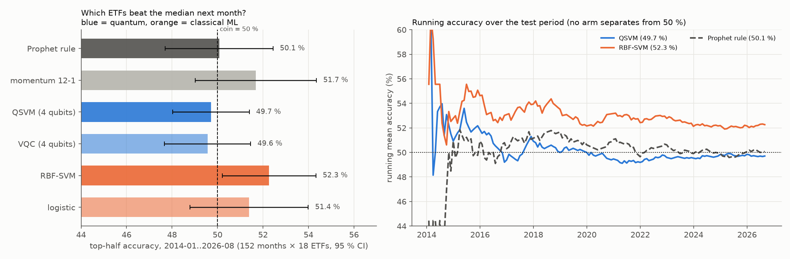
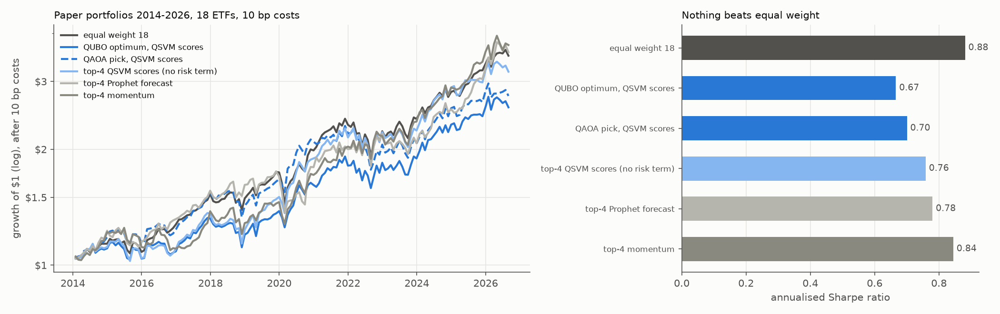
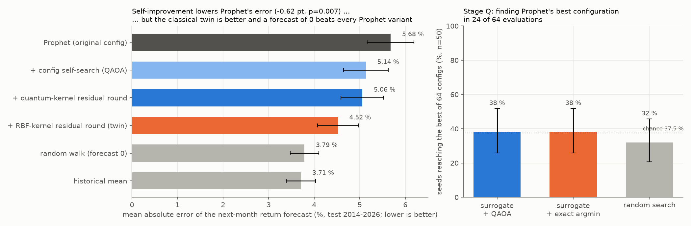
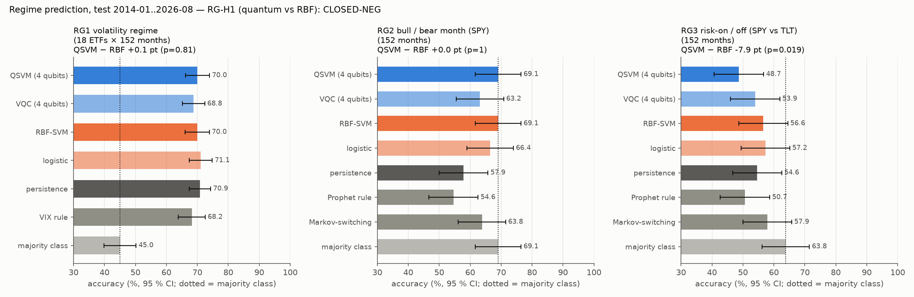
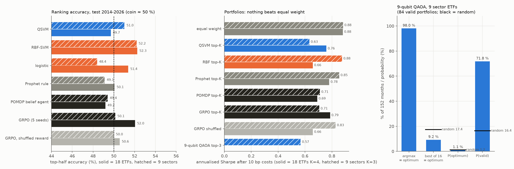
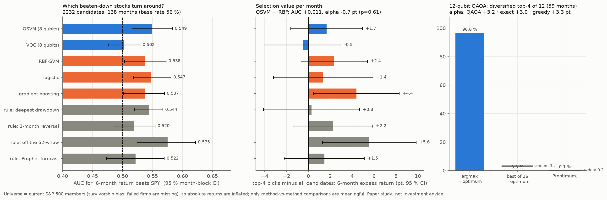

# Prophet + Quantum ML + QAOA on stock data — a pre-registered, honest benchmark

**IQ Hackathon Fall 2026 (Beginners)**

<p align="center"></p>

> Added on 2026-10-26, after the submission deadline: this picture
> ([`figures/make_coffee_machine.py`](figures/make_coffee_machine.py)) and the MCP server in
> [`mcp_server/`](mcp_server/README.md). The study, its results and the rest of this README are unchanged.

## Submission information

| | |
|---|---|
| Group name | ⟨fill in⟩ |
| Members (name · affiliation · department · career level) | Sunghoon Park · ⟨affiliation⟩ · ⟨department⟩ · ⟨career level⟩ |
| Submission category | ⟨Rising-star / Champion⟩ |
| Track | **Quantum Machine Learning** (primary), with a **QAOA** extension |
| Notebook | [`quantum_prophet_stocks.ipynb`](quantum_prophet_stocks.ipynb) — first cell installs every package |

## What we did (summary)

* Built monthly features for 18 ETFs from **Prophet** forecasts plus momentum/volatility, and compared
  a **4-qubit quantum-kernel SVM (QSVM)** and a **variational quantum classifier (VQC)** against RBF-SVM
  and logistic regression for "which ETFs beat the median next month" (walk-forward, 2014-2026).
* Used **QAOA** (18 qubits) to pick a monthly 4-ETF mean-variance portfolio from a QUBO and compared it
  with brute force and random sampling; repeated with **9 sector ETFs (9 qubits)**.
* Tried a **self-improvement loop** for Prophet (QAOA-driven configuration search + kernel residual boosting).
* Extended to **regime prediction** (volatility, bull/bear, risk-on/off) and to **POMDP / GRPO** agents.
* Applied the same tools to **turnaround stocks**: 5,124 S&P 500 stock-months ≥ 40 % below their 52-week
  high, 8-qubit QSVM / VQC, and a 12-qubit QAOA diversified pick ([`turnaround/`](turnaround/REPORT.md)).
* Verified every simulator against Qiskit, **pre-registered** every hypothesis before computing it, and
  checked each result with shuffled-label and planted-signal controls.

## Motivation

The training notebooks show quantum kernels and QAOA on textbook data (the `ad_hoc` dataset, a 5-node
max-cut). We wanted to know what happens on a noisy, real problem people care about — stock selection —
when the quantum methods get exactly the same data, features and tuning budget as standard classical
methods, and when the evaluation cannot be tuned after seeing the results.

## Summary of findings

**Answer: not on this problem.** In none of the comparisons did a quantum method beat its classical
counterpart, and Prophet's forecast carried no cross-sectional information one month ahead.
A self-improvement loop did make Prophet more accurate, but the classical version of the same loop
did better, and simply forecasting 0 % beat every Prophet variant. Volatility regimes *are*
predictable, but plain "this month's state persists" was as good as any model. For turnaround stocks
a weak signal exists, yet the simplest rule (stocks already rebounding off their 52-week low) beat every
learned model, quantum or classical. We think a clean, reproducible negative result with working
quantum pipelines is more useful than an unverified "quantum advantage" headline.



## Workflow

```
daily closes (18 ETFs, 2005-2026, frozen + sha256)
   └─ Prophet per ETF per month-end (730-day window, 30-day horizon)
        └─ features: Prophet forecast return, Prophet residual, 12-1 momentum, 21-day volatility
             ├─ QSVM  : ZZ feature map (4 qubits), exact statevector kernel, SVM      (QML notebook)
             ├─ VQC   : ZZ map + RealAmplitudes(reps 3), parity read-out, COBYLA       (QML notebook)
             ├─ classical twins: RBF-SVM, logistic regression, Prophet rule, momentum rule
             ├─ QAOA  : monthly top-K mean-variance portfolio QUBO, 18 qubits (9 for sectors) (QAOA notebook)
             ├─ RL    : POMDP belief agent (2-regime HMM filter) and GRPO policy (5 seeds)
             └─ self-improvement: QAOA-driven Prophet configuration search + kernel residual boosting
```

Target: is an ETF in the **top half of the 18 next month** (a coin scores 50 %). Hyper-parameters
were chosen on 2009-2013 only; the test (2014-01..2026-08: 152 months, 2,736 decisions) was run once.

## Why the numbers can be trusted

* **Pre-registered**: `PREREG.md` (+ amendments) fixed hypotheses, kill conditions and controls
  before computing anything; sha256 files let you check they were not edited (see `REDACTIONS.md`).
* **Frozen data**: `data/` with sha256; the code refuses to run on a different file.
* **No look-ahead**: every training sample's label must end on or before the decision date (asserted
  in code for every month).
* **Simulators verified against Qiskit** (`results/CONTROLS_SIM.json`): our batched kernel equals
  `FidelityStatevectorKernel` to 4e-15; our 18-qubit QAOA equals `QAOAAnsatz` + `Statevector` to 3e-14
  (fidelity 1 - 5e-15); our VQC forward pass equals Qiskit to 9e-16; the QSVM scores 1.0 on the
  notebook's `ad_hoc` dataset.
* **Controls**: a planted signal is detected; shuffled labels give 50 %; GRPO is checked against a
  shuffled-reward twin.

## Results

| question (pre-registered) | result | verdict |
|---|---|---|
| H1 Does Prophet's 30-day forecast rank next month's winners? | rank correlation 0.007 (p = 0.81); 50.1 % accuracy | no |
| H2 Quantum kernel (QSVM) vs classical RBF-SVM, same features | 49.7 % vs 52.3 % (−2.6 pt, p = 0.051) | no — quantum lower |
| VQC vs logistic regression | 49.6 % vs 51.4 % (−1.8 pt, p = 0.26) | no |
| H3 Does 18-qubit QAOA (p = 3) find the exact optimum of each month's QUBO? | optimum found in 20.4 % of 152 months — below 1,024 random valid portfolios (28.4 %); P(optimum) 0.027 % | no |
| H4 QAOA portfolio vs equal weight (Sharpe) | Sharpe 0.70 vs 0.88 (90 % CI of difference [-0.46, 0.09]) | no |
| H5 Can a self-improvement loop make Prophet more accurate? | error 5.68 % → 5.06 % (p = 0.007) | yes, but see below |





**Self-improvement, in context.** Most of the gain is Prophet switching off its own yearly
seasonality, a setting found by the configuration search. The QAOA-driven search found the best
setting no more often than random search (38 % vs 32 % of seeds; minimising the same surrogate
exactly also gave 38 %). The classical RBF version of the residual-boosting step beats the quantum
kernel version (4.52 % vs 5.06 %, p = 1e-4). And forecasting 0 % (3.79 %) or the historical mean
(3.71 %) still beats every Prophet variant.

### Regime prediction



| regime (test 2014-2026) | best | QSVM | RBF-SVM | persistence | majority |
|---|---|---|---|---|---|
| volatility (18 ETFs; next month above own median) | logistic 71.1 % | 70.0 % | 70.0 % | 70.9 % | 45.0 % |
| bull / bear month (SPY) | majority 69.1 % | 69.1 % | 69.1 % | 57.9 % | 69.1 % |
| risk-on / off (SPY vs TLT) | majority 63.8 % | 48.7 % | 56.6 % | 54.6 % | 63.8 % |

Quantum − RBF: +0.1 / 0.0 / −7.9 pt (Holm-adjusted p 1.0 / 1.0 / 0.056) → no quantum gain.
Volatility clusters, so persistence beats the majority class by 26 pt, and no model beats persistence.
Bull/bear and risk-on/off months were not predictable: nothing beat "always the majority regime",
including a Prophet rule (54.6 % / 50.7 %) and a Markov-switching model (63.8 % / 57.9 %).
One control was mis-specified and failed as written: shuffling volatility labels *within* a month
still leaves 67.5 % accuracy, because VIX predicts how many ETFs are volatile that month. This is
not leakage: the shuffled accuracy stays below the month-level oracle (78.9 %), and the
look-ahead checks pass. What it shows is that most volatility-regime skill is market-wide.

### Fewer assets (9 sector ETFs → 9 qubits) and RL agents



* **9-qubit QAOA (choose 3 of 9 sectors = 84 valid portfolios).** The most likely bitstring of the
  QAOA state is the optimum in 98 % of months, but the state is nearly flat: P(optimum) = 1.1 %,
  slightly *below* sampling the 84 valid portfolios uniformly (1.2 %). With 16 shots QAOA finds the
  optimum 9.2 % of the time vs 17.4 % for random valid draws → **fails** the pre-registered test.
  Portfolio Sharpe 0.57 vs equal weight 0.88.
* **POMDP belief agent:** 49.2 % accuracy, Sharpe 0.69. On bull/bear and risk-on/off months it always
  predicts the majority regime.
* **GRPO:** 52.0 % accuracy (5 seeds: 51.0-52.9 %). Its shuffled-reward twin scores 50.6 %, a difference
  of p = 0.21, so there is no evidence it learned beyond the control. Sharpe 0.79.
* Nothing beats the equal-weight portfolio (Sharpe 0.88).

### Turnaround stocks (S&P 500, 8 and 12 qubits) — details in [`turnaround/REPORT.md`](turnaround/REPORT.md)



* 2,232 test candidates (stocks ≥ 40 % below their 52-week high), 138 months; label = next-6-month return beats SPY.
* QSVM AUC 0.549 vs RBF 0.538 (difference CI [−0.003, +0.026] includes 0); QSVM's top-4 picks are 0.7 pt worse
  (p = 0.61). VQC is at chance (0.502). Best: the plain "furthest off the 52-week low" rule (AUC 0.575).
* 12-qubit QAOA never found the diversified optimum in 16 shots (0/59 months vs 3.2 % random).
* Survivorship bias (today's index members only) inflates absolute returns; comparisons are like-for-like.

### Live forecast (2026-10-23 close) — not investment advice

`results/LIVE_2026-10-23.md`: Prophet 30-day forecasts with 80 % intervals, QSVM / RBF ranks and the
QAOA top-4 pick, printed next to the backtest caveat that these ranks have no demonstrated value.

## What we learned

1. At 4-18 qubits a quantum kernel or QAOA is an exact classical computation; on this data it never
   beat the classical twin at equal budget. Brute force over the 3,060 valid 4-of-18 portfolios takes
   ~0.1 s; one 18-qubit QAOA optimisation took ~1 minute in simulation and found the optimum in only 20 % of months.
2. Shrinking the problem (9 sectors) makes QAOA's optimum the most likely state, but the state is
   so flat that shot-based sampling does worse than random valid sampling.
3. The bottleneck is the signal, not the solver: Prophet's forecasts, momentum and volatility ranks
   carry almost no cross-sectional information one month ahead.
4. Pre-registration + controls caught two things we would otherwise have misread: the
   self-improvement gain (mostly a configuration change, beaten by a zero forecast) and a
   mis-specified shuffle control.

## Data

Adjusted daily closes and VIX from Yahoo Finance via `yfinance`, frozen on 2026-10-17 (2005-01-03 →
2026-10-16; sha256 in `data/SHA256SUMS`). Because Prophet uses a 730-day window, features start in
January 2007, so the **2008 financial crisis (2007-10 → 2009-03, incl. the −16.5 % SPY month of
October 2008) is in every training window**. 2008 itself is not an out-of-sample test month here.
Yahoo data are shipped for reproducibility of this educational project only — check Yahoo's terms
before reusing them.

## Reproduce

```bash
python3.12 -m venv .venv && .venv/bin/pip install -r requirements.txt
.venv/bin/python run_controls_sim.py     # simulators vs Qiskit          (~1 min)
.venv/bin/python run_features.py         # 27k Prophet fits               (~4 min on 16 cores)
.venv/bin/python run_backtest.py         # H1, H2, VQC, controls          (~2 min)
.venv/bin/python run_qaoa_portfolio.py   # H3, H4: 152 sequential 18-qubit QAOA runs (~2-3 h)
.venv/bin/python run_rsi.py              # H5 self-improvement            (~12 min)
.venv/bin/python run_regime.py           # regimes                        (~10 min)
.venv/bin/python run_sector.py           # 9 sectors / 9-qubit QAOA       (~3 min)
.venv/bin/python run_rl.py               # POMDP / GRPO                   (~10 min)
.venv/bin/python make_figures.py
.venv/bin/python make_notebook.py && .venv/bin/jupyter nbconvert --to notebook --execute --inplace quantum_prophet_stocks.ipynb
.venv/bin/python run_live.py             # needs internet
```
All results are already in `results/`, so the notebook runs without the long jobs.

## Files

`quantum_prophet_stocks.ipynb` walkthrough (runs live Prophet / QSVM / 8-qubit Qiskit QAOA demos) ·
`qps/` library (`quantum.py` kernel / VQC / QAOA, `prophet_feats.py`, `panel.py`, `rl_agents.py`) ·
`run_*.py` experiments · `results/` all outputs · `figures/` · `PREREG*.md` pre-registration.

## Exploratory QML ensemble selection

Open [`quantum_ensemble_selector.ipynb`](quantum_ensemble_selector.ipynb) for the
executed experiment, result tables, plots, and reproducibility checks.

[`run_ensemble_selector.py`](run_ensemble_selector.py) tests a four-qubit quantum
kernel meta-selector that chooses one of 15 equal-weight pairs of the six saved
forecasters. Hyperparameters use 2016–2018 only; expanding walk-forward evaluation
uses 2019-01 through 2026-08 (92 months). The QML selector's rank-score Brier loss
is 0.301850 versus RBF 0.297816 and all-six equal weight 0.276494 (lower is better).
Top-9 accuracy is 49.52%, 49.76%, and 52.42%, respectively. QML finds the hindsight
optimal pair in 4.35% of months; RBF does in 8.70%. The paired RBF-minus-QML Brier
95% block-bootstrap interval is [−0.014311, +0.005659]: no demonstrated QML benefit.
This reuses an already examined dataset and is exploratory, not a fresh holdout.
See [`ENSEMBLE_PROTOCOL.md`](ENSEMBLE_PROTOCOL.md) and the
[`full report`](results/ensemble_selector/REPORT.md). Run with the project's Python
dependencies: `python run_ensemble_selector.py`.

## MCP server: the machine as tools (added 2026-10-26)

[`mcp_server/`](mcp_server/README.md) exposes the pipeline to any MCP client (Claude Code, Claude Desktop,
your own agent): `brew_portfolio` (coffee preset → risk aversion → QAOA basket, reported next to the
exact optimum and equal weight), `prophet_forecast`, `qsvm_rank`, `list_universe` and `study_results`.

```bash
.venv/bin/pip install -r mcp_server/requirements.txt
.venv/bin/python mcp_server/smoke_test.py   # end-to-end over stdio, offline
claude mcp add q-brew -- "$PWD/.venv/bin/python" "$PWD/mcp_server/coffee_portfolio_server.py"
```

## Limits

One universe of 18 liquid ETFs, monthly horizon, one feature set; 10 bp per unit turnover; no taxes,
slippage or execution delay. All quantum circuits are exact classical simulations (no hardware
noise), so nothing here is a claim about quantum advantage.

## References

Havlíček et al., *Supervised learning with quantum-enhanced feature spaces*, Nature 2019 ·
Farhi, Goldstone & Gutmann, *A Quantum Approximate Optimization Algorithm*, arXiv:1411.4028 ·
Taylor & Letham, *Forecasting at scale* (Prophet), Am. Stat. 2018 ·
Shao et al., *DeepSeekMath* (GRPO), arXiv:2402.03300 · Hamilton, *A new approach to the economic
analysis of nonstationary time series* (Markov switching), Econometrica 1989 ·
IQ Hackathon Fall 2026 Training Session II notebooks.
