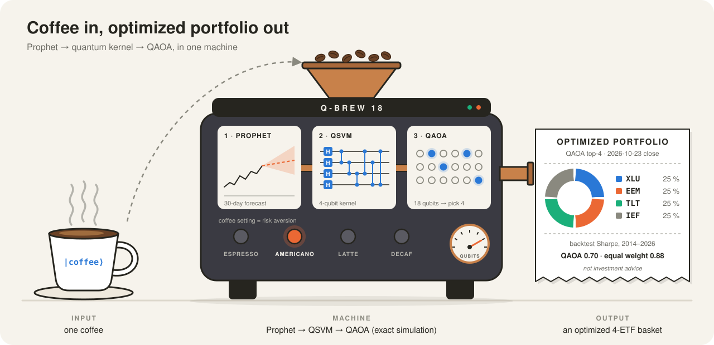

# Q-BREW — the coffee-to-portfolio machine as an MCP server



An [MCP](https://modelcontextprotocol.io) server that exposes this repository's pipeline
(Prophet forecast → 4-qubit quantum-kernel SVM → 18-qubit QAOA) as tools any MCP client can call:
Claude Code, Claude Desktop, or your own agent. Added on 2026-10-26, after the hackathon
submission; the study and its results are unchanged.

Every quantum circuit is an **exact classical statevector simulation** (`qps/quantum.py`, checked
against Qiskit in `results/CONTROLS_SIM.json`). Nothing here is investment advice, and the
pre-registered backtest found **no quantum advantage**: `study_results` returns those verdicts so an
agent can quote them next to any output.

## Tools

| tool | what it returns |
|---|---|
| `brew_portfolio(coffee, k, signal, assets, as_of, qaoa_layers, maxiter, shots, seed)` | QAOA basket of `k` assets (one qubit per asset, ≤ 18), the exact optimum by brute force, P(optimum) in the QAOA state vs uniform, approximation ratio, ex-ante volatility of the basket / optimum / equal weight |
| `prophet_forecast(ticker, as_of)` | Prophet 30-day forecast with 80 % interval and BULLISH / BEARISH / NEUTRAL (±3 %) |
| `qsvm_rank(as_of)` | QSVM and RBF-SVM ranks of the 18 ETFs; for past month-ends also the realised top-half accuracy |
| `list_universe()` | the 18 ETFs, the frozen price file (sha256, dates), the coffee presets |
| `study_results()` | the pre-registered verdicts (read from `results/*.json`) |

**Coffee = risk aversion** γ in the study's QUBO
`E(x) = −μ·x + γ/(2k)·xᵀΣx + A(Σx − k)²` (`run_qaoa_portfolio.py`):

| coffee | γ | meaning |
|---|---|---|
| `espresso` | 0.25 | follows the return signal, small variance penalty |
| `americano` | 1 | the study's setting |
| `latte` | 3 | three times the variance penalty |
| `decaf` | 10 | close to the minimum-variance basket |

`signal` is the reward μ (standardised across the assets): `qsvm` (the study's choice, 18 study ETFs
only), `prophet` (Prophet forecast return) or `momentum` (12-1 momentum). Σ is the last 252 days'
covariance.

`as_of`: a date `YYYY-MM-DD` inside the frozen price file (2005-01-03 … 2026-10-16; offline and
reproducible), omitted = its last day, or `"live"` (fresh Yahoo prices through `yfinance`, any ticker
for `prophet_forecast` / `brew_portfolio` with `prophet` or `momentum`; during market hours the last
row is an intraday price). Month-ends up to 2026-09-30 reuse the study's Prophet features; other dates
refit Prophet per ETF (a few seconds).

## Install and connect

From the repository root, with the environment of the main README:

```bash
.venv/bin/pip install -r mcp_server/requirements.txt
.venv/bin/python mcp_server/smoke_test.py      # starts the server over stdio, calls every tool (~45 s, offline)
```

Claude Code:

```bash
claude mcp add q-brew -- "$PWD/.venv/bin/python" "$PWD/mcp_server/coffee_portfolio_server.py"
```

Claude Desktop (`claude_desktop_config.json`, absolute paths):

```json
{
  "mcpServers": {
    "q-brew": {
      "command": "/ABSOLUTE/PATH/IQ_Hackathon_Fall_2026/.venv/bin/python",
      "args": ["/ABSOLUTE/PATH/IQ_Hackathon_Fall_2026/mcp_server/coffee_portfolio_server.py"]
    }
  }
}
```

Then ask, for example: *"Brew me a decaf portfolio as of 2026-09-30 and tell me whether QAOA found the
optimum."*

## Example

`brew_portfolio(coffee="decaf", as_of="2026-09-30")` (18 qubits, QSVM signal, ~10 s), abridged:

```json
{
  "coffee": "decaf",
  "risk_aversion": 10.0,
  "as_of": "2026-09-30",
  "signal": "qsvm",
  "qubits": 18,
  "portfolio":     {"XLF": 0.25, "XLP": 0.25, "QQQ": 0.25, "IEF": 0.25},
  "exact_optimum": {"XLF": 0.25, "XLP": 0.25, "QQQ": 0.25, "TLT": 0.25},
  "qaoa_found_exact_optimum": false,
  "approximation_ratio": 0.9975,
  "p_optimum_in_qaoa_state": 0.0001,
  "p_optimum_uniform_valid": 0.0003,
  "ex_ante_volatility": {"portfolio": 0.0811, "exact_optimum": 0.0861, "equal_weight_all": 0.1041},
  "backtest_caveat": "Pre-registered backtest 2014-2026 (18 ETFs, americano, QSVM signal): Sharpe QAOA 0.70 vs equal weight 0.88. Paper study, not investment advice."
}
```

As in the study, the QAOA state puts *less* probability on the optimum than uniform sampling of the
3,060 valid baskets does; with 1,024 shots it still returns a near-optimal basket.

## What the smoke test checks

* the server's QUBO equals the study's `build_cost` at γ = 1 (max |difference| 0);
* all five tools answer over a real stdio connection, including 18 Prophet refits (nothing may
  write to stdout, which carries the protocol);
* the Prophet forecast lies inside its own 80 % interval; the QSVM ranks are a permutation of 1-18;
* stronger risk aversion never raises the exact optimum's variance (decaf 0.090 vs espresso 0.130
  annualised volatility on 2026-09-30);
* an unknown coffee is rejected with a readable error.

Tested with `mcp` 2.3.0 on Python 3.12.
